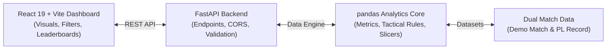

# ⚽ MatchMind AI

### Explainable Football Match Intelligence Platform

MatchMind AI transforms raw football match records and event streams into explainable tactical recommendations, player-level performance metrics, interactive multi-factor filters, visual shot timelines, and head-to-head comparisons.

Built for the **Inside the Game: Developer Hackathon** presented by **Microsoft & Premier League**.

---

## 🚀 Key Features

1. **Dual Match Dataset Architecture:**
   - **Match 1 (Demonstration Showcase):** Manchester City 2 – 1 Arsenal (*Fictional sample events for baseline testing and rule calibration*).
   - **Match 2 (Illustrative Premier League Record):** Arsenal 1 – 0 Manchester City (*Gameweek 8, 8 October 2023 at Emirates Stadium; verified official box score with illustrative key-event sample*).
2. **Dynamic Dataset Switcher:** One-click toggle between demonstration showcase and real-world match record with distinct visual badges (`DEMO DATA` vs `ILLUSTRATIVE REAL RECORD`).
3. **Audience Persona Switcher (Analyst Mode vs Casual Fan Mode):** Seamless one-click toggle in top navigation:
   - **Analyst Mode:** Detailed telemetry, tactical coaching recommendations, pass accuracy/shot conversion ratios, player leaderboards with tie-breaker criteria, and raw event comparisons.
   - **Casual Fan Mode:** Plain-English storytelling, 1-minute match narrative cards, "What Went Well" coaching summaries, simplified player spotlight badges (Goal Decider, Attack Catalyst, Midfield Engine), and supporter head-to-head verdicts.
4. **Match Centre & Scoreboard:** Official scores, possession share, total shots, shots on target, and completed pass tracking.
5. **Automated Match Insights:** Deterministic, rule-based observations highlighting possession dominance, attacking efficiency, and conversion margins.
6. **Visual Match Analytics:**
   - Interactive **Shot Timeline** (0′ to 90′) with team color-coding and goal markers.
   - **Team Performance Comparison** bars for shots, shots on target, and goals.
   - **Passing Accuracy** visual tracking with progress fills.
7. **Tactical Intelligence Engine:** Automated diagnosis of attacking volume and ball circulation safety with actionable coaching recommendations.
8. **Player Performance Analytics:** Individual statistics for passes attempted/completed, pass accuracy percentage (with zero-division protection when no passes are attempted), total shots, shots on target, goals, and conversion percentage.
9. **Player Rankings & Leaderboards:** Leaderboards for Top Goalscorers, Shot Threats, and Pass Completers with transparent tie-breaker criteria and team filter controls.
10. **Head-to-Head Player Comparison:** Interactive tool comparing any two players side-by-side with automated observation highlights.
11. **Interactive Multi-Factor Filters:** Live filtering by Team, Player, Event Type (Passes/Shots), and Match Minute range (0′–90′), updating charts, timeline, and event logs in real time.

---

## 🏗️ Architecture Overview



- **Frontend:** React 19, Vite, Vanilla CSS (Dark theme with `#b6f36b` green accents). Zero external UI framework bloat.
- **Backend:** Python FastAPI, Uvicorn, Starlette. High-performance asynchronous REST API.
- **Data Engine:** pandas, NumPy. Vectorized aggregation for passing accuracy, shot conversion, and deterministic tie-breaking.
- **Architecture Details:** See [`docs/ARCHITECTURE.md`](docs/ARCHITECTURE.md) for full component breakdown and sequence diagrams.

---

## 🏃 Setup and Run Instructions

### Prerequisites
- Python 3.11+ (or existing `.venv`)
- Node.js 18+ and npm

### 1. Backend Setup
From the repository root:

```powershell
# Activate virtual environment
.\.venv\Scripts\Activate.ps1

# Start FastAPI server on port 8000
python -m uvicorn backend.main:app --port 8000 --reload
```

The API will be available at:
- **API Base:** `http://127.0.0.1:8000/`
- **Interactive OpenAPI Documentation:** `http://127.0.0.1:8000/docs`
- **Health Check Endpoint:** `http://127.0.0.1:8000/health`

### 2. Frontend Setup
In a second terminal:

```powershell
# Navigate into frontend
cd frontend

# Install dependencies (if needed)
npm install

# Start Vite development server
npm run dev
```

Open your browser to:
- **Frontend Application:** `http://localhost:5173/`

---

## 🧪 Testing and Verification

### Backend Automated Test Suite
Run the 18 automated tests covering endpoints, analytics calculations, zero-division guards, rankings, persona data integrity, and filters:

```powershell
.\.venv\Scripts\python.exe -m unittest discover -s tests -v
```

### Frontend Linting & Production Build Checks
```powershell
# Run Oxlint
npm --prefix frontend run lint

# Run Vite production build
npm --prefix frontend run build
```

---

## 📊 Free Football Data Evaluation & Limitations

MatchMind AI operates under a strict **Zero-Cost & Zero-Risk Mandate**:
- **No Paid APIs:** Commercial feeds (Opta, Sportmonks, Wyscout) require paid enterprise subscriptions ($50 to $500+/month) or have credit card overage billing risks.
- **Free Tier Limitations:** Services such as Football-Data.org enforce strict rate limits (10 requests/minute) and only offer high-level match results without raw pitch event coordinates.
- **Match 2 Data Provenance:**
  - **Verified Box Score:** Sourced from official Premier League match records for Arsenal 1–0 Manchester City on 8 October 2023 (Possession: 49% vs 51%, Shots: 12 vs 4, Shots on target: 2 vs 1, Passes completed: 433 vs 453).
  - **Illustrative Key Events:** Full live matches generate ~1,800 micro-events. The 10 recorded match events represent an illustrative reconstructed key-event sample based on official match timeline logs (e.g. Martinelli 86′ winner, Gvardiol 4′ shot off the line).
  - **Data Attribution:** Sourced following OpenFootball (`openfootball`) and StatsBomb Open Data standards under CC0 1.0 Universal / CC BY 4.0 licenses.
  - **Detailed Audit:** See [`docs/REAL_FOOTBALL_DATA_AUDIT.md`](docs/REAL_FOOTBALL_DATA_AUDIT.md) for the complete evaluation matrix.

---

## 🏆 Hackathon Submission & Demo

- **Hackathon:** Inside the Game: Developer Hackathon (Microsoft & Premier League)
- **Submission Guide:** [`docs/HACKATHON_SUBMISSION_GUIDE.md`](docs/HACKATHON_SUBMISSION_GUIDE.md) — Includes:
  - Strict **Under-2-Minute Video Recording Script** (< 120s)
  - 3-Minute Live Presentation & Q&A Script
  - Devpost / Submission Portal Checklist
  - Pre-submission git verification
