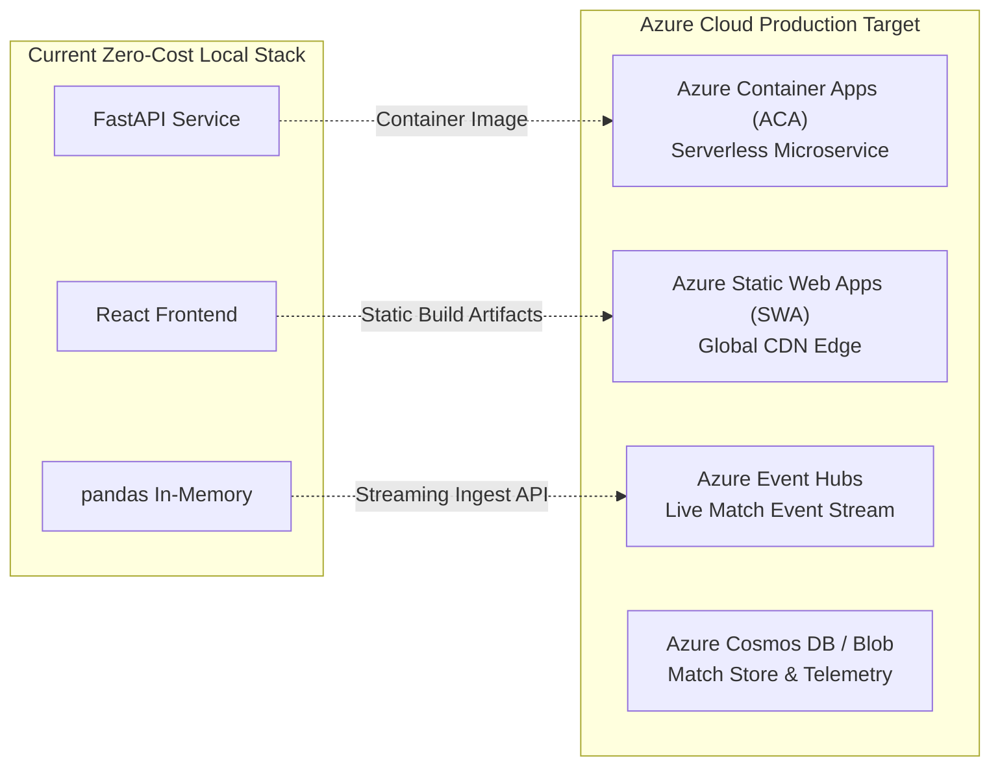

# MatchMind AI — Architecture Overview

MatchMind AI is built as a modular, explainable football match intelligence and broadcast analytics platform. It processes match-level statistics, dynamic event streams, and tactical patterns locally, generating automated tactical diagnoses, player performance analytics, and dynamic visual dashboards without external paid API dependencies.

---

## 🏗️ High-Level System Architecture

```mermaid
flowchart TD
    subgraph UI ["Frontend (React 19 + Vite)"]
        A[Dashboard Topbar & Persona Switcher]
        B[Broadcast Overlay View OBS Ready]
        C[Match Centre & Scoreboard]
        D[Important Moments Breakdown]
        E[Pattern Detection Cards]
        F[Overview Statistics & Comparison Tracks]
        G[Interactive Multi-Factor Filter Bar]
        H[Visual Match Analytics: Shot Timeline & Pass Track]
        I[Tactical Intelligence Report Engine]
        J[Player Analytics & Metric Cards]
        K[Player Leaderboards & Tie-Breakers]
        L[Head-to-Head Player Comparison]
        M[Key Match Event Log]
    end

    subgraph API ["Backend API (FastAPI)"]
        N["/api/matches & /api/matches/{id}"]
        O["/api/matches/{id}/important-moments"]
        P["/api/matches/{id}/patterns"]
        Q["/api/custom-matches/ingest (POST)"]
        R["/api/custom-matches (GET/DELETE)"]
        S["/api/matches/{id}/analytics & /events"]
        T["/api/matches/{id}/players & /player-rankings"]
        U["/api/matches/{id}/player-comparison"]
        V["/api/matches/{id}/tactical-analysis"]
    end

    subgraph ENGINE ["Analytics & Data Layer (pandas)"]
        W[Dynamic Event Ingest & Slicer]
        X[Important Moments Classifier]
        Y[Pattern Detection Engine]
        Z[Advanced Metric Engine: Pass Acc, Shots on Target, Conv %]
        AA[Tactical Rule Engine]
        AB[Individual Player Analytics Engine]
        AC[Deterministic Ranking & Tie-Breaker Engine]
    end

    subgraph DATA ["Match Datasets & Ingest Store"]
        AD1["Match 1: Demo Showcase (Fictional Sample Events)"]
        AD2["Match 2: Premier League 2023/24 Record (Verified Box Score & Illustrative Key Events)"]
        AD3["Custom Matches Store (In-Memory / Isolated IDs >= 1000)"]
    end

    A & B & C & D & E & F & G & H & I & J & K & L & M <-->|REST API| N & O & P & Q & R & S & T & U & V
    N & O & P & Q & R & S & T & U & V <--> ENGINE
    ENGINE <--> DATA
```

---

## 🧩 Architectural Components

### 1. Frontend Layer (`frontend/`)
- **Technology:** React 19, Vite, Vanilla CSS.
- **Design System:** Dark theme (`#0b100e`, `#151d18`) with high-contrast electric green (`#b6f36b`) and tactical accents.
- **Persona Architecture:** Seamless topbar toggle between **Analyst Mode** (technical metrics, passing breakdown, coaching diagnosis) and **Casual Fan Mode** (plain-English match narratives, hero badges, "What Went Well" coach cards).
- **Broadcast Overlay Subsystem:** OBS-friendly lower-third and compact scorebug displays with transparent backdrop toggle for direct streaming alpha channel ingestion.
- **State Management:** Reactive component-level state with zero unnecessary re-renders. Uses derived state patterns for player comparisons to prevent out-of-sync states during match switching.
- **Responsive Layout:** CSS Grid and Flexbox with mobile-first breakpoints (<=600px, <=850px, desktop).

### 2. Backend REST API Layer (`backend/main.py`)
- **Technology:** FastAPI, Uvicorn, Starlette.
- **CORS Support:** Configured for local development (`http://localhost:5173`, `http://127.0.0.1:5173`, `http://localhost:3000`, `http://localhost:8080`).
- **RESTful Endpoints:**
  - `GET /health` — Service health probe.
  - `GET /api/matches` — Lists all available match datasets with provenance metadata.
  - `GET /api/matches/{id}` — Match overview, score, venue, and box-score statistics.
  - `GET /api/matches/{id}/analytics` — Team-level event analytics.
  - `GET /api/matches/{id}/insights` — Automated rule-based observations.
  - `GET /api/matches/{id}/events` — Event stream with multi-factor filtering (`team`, `player`, `event_type`, `start_minute`, `end_minute`).
  - `GET /api/matches/{id}/players` — Individual player metrics.
  - `GET /api/matches/{id}/player-rankings` — Deterministic leaderboards with explicit tie-breakers.
  - `GET /api/matches/{id}/player-comparison` — Head-to-head comparison between any two players.
  - `GET /api/matches/{id}/tactical-analysis` — Tactical diagnostic report and coaching recommendations.
  - `GET /api/matches/{id}/important-moments` — Fact-vs-interpretation breakdown with sequence caveats.
  - `GET /api/matches/{id}/patterns` — Quantified football pattern detection (composure, conversion, clumping).
  - `POST /api/custom-matches/ingest` — Pydantic-validated ingestion endpoint for custom event datasets.
  - `GET /api/custom-matches` — List all dynamically ingested matches.
  - `DELETE /api/custom-matches/{id}` — Remove a custom ingested match (built-in matches 1 & 2 are protected).

### 3. Analytics & Intelligence Engine (`backend/analytics.py`)
- **Technology:** pandas, NumPy.
- **Calculation Logic:**
  - **Pass Accuracy %:** `(completed / attempted) * 100`, guarded against zero division (`None` when attempted = 0).
  - **Shots on Target %:** `(shots on target / total shots) * 100`.
  - **Shot Conversion %:** `(goals / total shots) * 100`.
- **Ranking Engine:** Multi-key deterministic sorting:
  - Top Scorers: `(-goals, -shot_conversion_percent, -shots)`
  - Shot Threats: `(-shots, -shots_on_target, -shots_on_target_percent)`
  - Completed Passes: `(-passes_completed, -pass_accuracy_percent)`
- **Pattern Detection Engine:**
  - **Finishing Precision:** Evaluates clinical execution vs wasteful shooting margins.
  - **Ball Circulation Composure:** Contrasts passing completion under high match tempo vs controlled phases.
  - **Temporal Danger Clumping:** Detects clustering of attacking actions across match quarters (0-25', 26-45', 46-70', 71-90+').
- **Important Moments Classifier:** Separates objective pitch events (minute, player, event type, result) from qualitative analytical interpretations, appending explicit timeline sequence caveats.

### 4. Dynamic Ingestion & Dataset Isolation
- **Dataset Isolation:** Custom ingested matches receive isolated IDs starting at 1001. Built-in Match 1 (synthetic demonstration) and Match 2 (verified Premier League fixture) are immutable.
- **Schema Validation:** Strict Pydantic models reject invalid states (e.g. passes with outcome "goal", shots with outcome "complete", events with invalid minute ranges, or teams not matching match metadata).
- **Auto-computation:** The ingestion engine automatically tallies team scorelines, shot totals, shots on target, passes completed, and possession percentage from raw ingested events.

---

## ☁️ Microsoft Ecosystem & Cloud Readiness Roadmap

MatchMind AI is built using open standards that map directly to the Microsoft Azure Cloud architecture:

1. **Azure Container Apps (ACA):** The provided root `Dockerfile` and `docker-compose.yml` can be deployed directly to Azure Container Apps free tier (180,000 vCPU-seconds and 360,000 GiB-seconds free per month) using `az containerapp up`.
2. **Azure Static Web Apps (SWA):** The Vite production build in `frontend/dist` is zero-config deployable to Azure Static Web Apps with built-in SSL and custom domain mapping.
3. **Azure Event Hubs & Stream Analytics:** The dynamic ingestion endpoint (`POST /api/custom-matches/ingest`) mirrors an Event Hubs consumer, allowing high-throughput ingestion of live Premier League ball-tracking feeds.
4. **Data Privacy & Zero Paid Cost:** Operates fully without billing activation or credential leakage, ensuring reproducible judge evaluation.

---

## 🔒 Security Principles

- **Zero Paid Dependencies:** No cloud subscriptions, no paid APIs, no rate-limited paywalls.
- **No Secrets Exposed:** Zero API keys, passwords, or credentials in codebase or Git history.
- **Resilient Execution:** 100% functional locally and offline.
