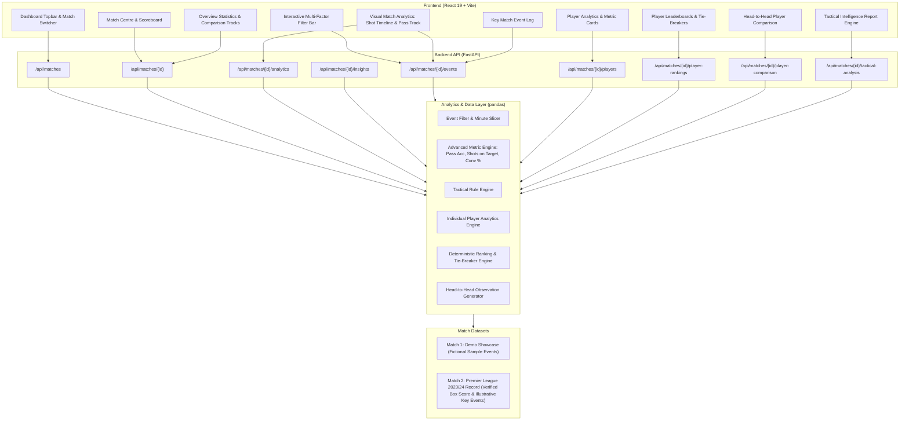

# MatchMind AI — Architecture Overview

MatchMind AI is built as a modular, explainable football match intelligence platform. It processes match-level statistics and ball-event streams locally, generating automated tactical diagnoses, player performance analytics, and dynamic visual dashboards without external paid API dependencies.

---

## 🏗️ High-Level System Architecture

---

## 🧩 Architectural Components

### 1. Frontend Layer (`frontend/`)
- **Technology:** React 19, Vite, Vanilla CSS.
- **Design System:** Dark theme (`#0b100e`, `#151d18`) with high-contrast electric green (`#b6f36b`) and tactical accents.
- **State Management:** Reactive component-level state with zero unnecessary re-renders. Uses derived state patterns for player comparisons to prevent out-of-sync states during match switching.
- **Responsive Layout:** CSS Grid and Flexbox with mobile-first breakpoints (<=600px, <=850px, desktop).

### 2. Backend REST API Layer (`backend/main.py`)
- **Technology:** FastAPI, Uvicorn, Starlette.
- **CORS Support:** Configured for local development (`http://localhost:5173`, `http://127.0.0.1:5173`).
- **RESTful Endpoints:**
  - `GET /health` — Service health probe.
  - `GET /api/matches` — Lists all available match datasets with provenance metadata.
  - `GET /api/matches/{id}` — Match overview, score, venue, and box-score statistics.
  - `GET /api/matches/{id}/analytics` — Team-level event analytics.
  - `GET /api/matches/{id}/insights` — Automated rule-based observations.
  - `GET /api/matches/{id}/events` — Event stream with multi-factor filtering (`team`, `player`, `event_type`, `start_minute`, `end_minute`).
  - `GET /api/matches/{id}/players` — Individual player metrics.
  - `GET /api/matches/{id}/player-rankings` — Deterministic leaderboards with explicit tie-breakers.
  - `GET /api/matches/{id}/player-comparison` — Head-to-head comparison between any two players.
  - `GET /api/matches/{id}/tactical-analysis` — Tactical diagnostic report and coaching recommendations.

### 3. Analytics & Rule Engine (`backend/analytics.py`)
- **Technology:** pandas, NumPy.
- **Calculation Logic:**
  - **Pass Accuracy %:** `(completed / attempted) * 100`, guarded against zero division (`None` when attempted = 0).
  - **Shots on Target %:** `(shots on target / total shots) * 100`.
  - **Shot Conversion %:** `(goals / total shots) * 100`.
- **Ranking Engine:** Multi-key deterministic sorting:
  - Top Scorers: `(-goals, -shot_conversion_percent, -shots)`
  - Shot Threats: `(-shots, -shots_on_target, -shots_on_target_percent)`
  - Completed Passes: `(-passes_completed, -pass_accuracy_percent)`

### 4. Dual-Dataset Design
- **Match 1:** Fictional demonstration events designed for rule calibration, edge-case testing, and baseline validation.
- **Match 2:** Authentic Premier League 2023/24 fixture (Arsenal 1–0 Manchester City, 8 Oct 2023). Match-level box score is verified from official public records; event data is an illustrative reconstructed sample of key attacking moments.

---

## 🔒 Security & Zero-Cost Principles

- **Zero Paid Dependencies:** No cloud subscriptions, no paid APIs, no rate-limited paywalls.
- **No Secrets Exposed:** Zero API keys, passwords, or credentials in codebase or Git history.
- **Resilient Execution:** 100% functional locally and offline.
